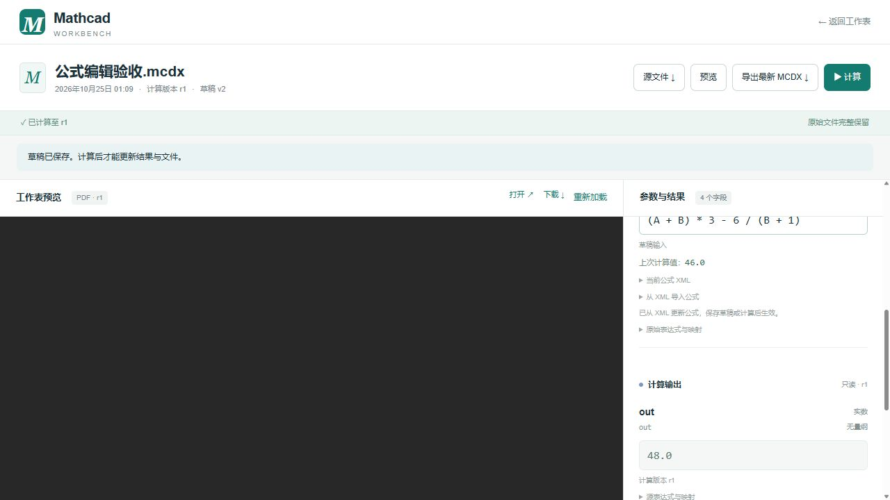

# 受限公式编辑验收（2026-10-25）

本次新增流程：网页编辑已有公式输入 → 后端校验语法和前置变量 → 草稿/计算快照 → 工作副本公式 XML → Mathcad COM 重算 → MCDX 保存重开核对 → 同版本原生 PDF。

## 支持范围

- 加减乘除、括号、一元正负号、科学计数法和前置输入定义变量；支持中文/希腊字母变量名。
- 公式转 Mathcad MathML XML；define、worksheet math 包装及右侧表达式 XML 转公式。导入不会修改左侧变量名。
- 不执行 Python 表达式。未知变量、自引用、后置变量、IO alias 替代变量名、函数/幂/索引及 DTD/实体均拒绝。
- 原有实数框仍输入数值；本次只扩展原本由受限公式定义的输入。布局、原始源文件及历史版本保持不变。

## 验证结果

| 环节 | 结果及证据 |
|---|---|
| 后端 | 80 项测试通过；覆盖优先级、括号、往返转换、非法语法/变量/XML、任务快照、工作副本、老文档升级及已有服务逻辑 |
| 静态检查 | Ruff、Python compileall、TypeScript 检查、Next.js 生产构建通过 |
| 现有数据升级 | 原字段 ID 保留；A=14、B=2 草稿不变；C 从只读扩展为公式输入；旧 revision 没有 C 输入快照时按源文件公式补齐比较基线，页面不误标输入已修改 |
| 原件/历史保留 | 升级前 4 个文档源文件哈希不变、全部原数值草稿不变；原 8 个计算记录及 4 个产物保留，验收新增 1 个计算记录和 2 个产物 |
| 双向转换 API | 通过 3000 端口 Next.js 同源转发，带 CSRF cookie/header；公式转 XML 再导入结果一致；自引用、输出名、缺括号、隐式乘法、幂返回 422 |
| 真实 Mathcad | 独立上传“公式编辑验收.mcdx”，A=14、B=2、C=`(A+B)*3-6/(B+1)`；Prime 12.0.1.0 使用 Dispatch，读回 C=46、输出 B+C=48 |
| MCDX | 保存后 XML 结构与提交表达式一致；真实 Prime 重开、输入输出核对通过；原文件字节不变 |
| PDF | 原生 SaveAs(.pdf) 成功，505522 字节、1 页，可严格解析，提取文本包含输出 48；再次请求预览 cached=true |
| 浏览器 | 公式可编辑、允许变量 A/B 可见；A+C 显示自引用错误；修改清除错误；公式 XML 显示正确；XML 导入更新为标准格式并成功保存草稿，语义相同的格式化不会误标过期；控制台无错误/警告 |

验收文档 ID：`65142151-402d-43a6-b17a-a500fde5aad7`，计算版本 r1。生成产物：

- MCDX：`data/documents/65142151-402d-43a6-b17a-a500fde5aad7/revisions/1/b1c93eb8-b38c-4b06-a90c-2c0910d790ba.mcdx`
- PDF：`data/documents/65142151-402d-43a6-b17a-a500fde5aad7/revisions/1/eb86dd75-fa22-4bc2-8f7e-6fc64100d798.pdf`

原生 PDF 的对象头空白会触发 pypdf 提示，但文件通过严格解析及内容核对。内嵌浏览器未渲染该 PDF 的页面内容，本次未将此视为视觉预览通过；已核对下载响应、文件哈希、实际公式 XML 和 PDF 文本。PDF 菜单/打印窗口均未操作。

本机原始升级备份和机器可读验证证据在 `.cache/formula-upgrade-20261025/`；目录包含 SQLite 升级前备份、升级前后哈希/草稿清单和实际计算报告。

